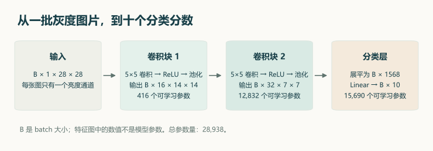
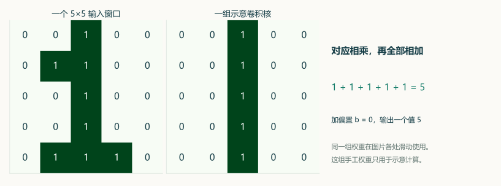
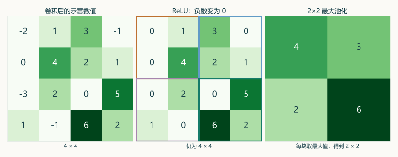
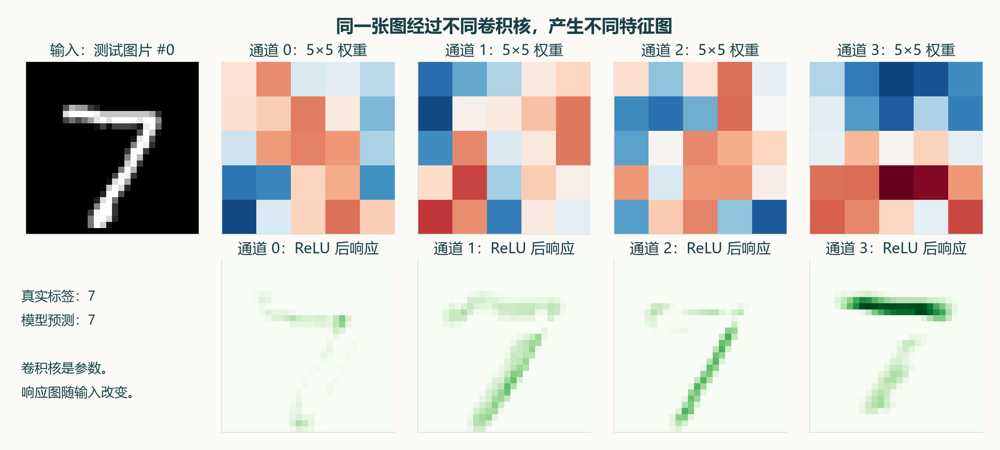

# 卷积网络：从像素到分类分数

网络要学到的不是某张图片在第几个文件，而是图片中哪些局部结构有助于判断类别。本实验用两层卷积提取特征，再用线性层将这些特征组合为十个分类分数。输入维度的含义见 [数据与张量](data.md#tensor-shape)。

## 先沿着形状走一遍 {#architecture}

[](assets/architecture.svg)

图中的一个卷积块包含 Conv2d、ReLU 和 MaxPool2d。每个块既改变通道数，又将空间宽高减半；只有卷积负责学习参数，ReLU 与最大池化没有可学习权重。
{: .figure-caption }

| 操作 | 单张图片对应的输出 | 作用 |
| --- | --- | --- |
| 输入 | `1 × 28 × 28` | 原始灰度亮度 |
| `Conv2d(1, 16, 5, padding=2)` | `16 × 28 × 28` | 学习 16 组局部响应 |
| ReLU | `16 × 28 × 28` | 将负值变为 0，引入非线性 |
| `MaxPool2d(2)` | `16 × 14 × 14` | 每个 2 × 2 区域保留最大响应 |
| `Conv2d(16, 32, 5, padding=2)` | `32 × 14 × 14` | 组合已有的通道信息 |
| ReLU、`MaxPool2d(2)` | `32 × 7 × 7` | 激活后再次缩小空间尺寸 |
| 展平 | `1568` | 将一张图的所有特征排列成一行 |
| `Linear(1568, 10)` | `10` | 得到数字 0～9 的原始分数 |

上表省略了始终存在的 batch 维，实际计算中每一行前面都有 `B`。网络不会把不同图片的像素混合成一张特征图。

`CNN` 继承 `nn.Module`，将卷积块和线性层赋给实例属性后，PyTorch 可以登记这些子模块、收集参数，并统一迁移设备或切换模式。`super().__init__()` 先完成模块本身的初始化；这些层不只是普通列表里的几个函数。

`nn.Sequential` 表示按顺序把上一层输出交给下一层。调用 `cnn(images)` 时，框架会进入 `forward()` 并保留相关模块机制；forward 描述数据怎样经过已经定义的层，真正学习到的权重保存在这些层中。

## 卷积到底在计算什么 {#convolution}

先看一个输出通道。卷积核是一小组可学习权重，它在输入上移动，每次读取一个局部窗口，对应位置相乘后相加，再加上偏置，得到输出特征图中的一个值。

[](assets/convolution.svg)

这里手工设置卷积核中间一列的权重为 1，其余为 0，偏置为 0，便于看清“对应相乘再求和”。它是计算示意，不是本次训练后的真实权重，也不是说所有卷积核都应该这样初始化。
{: .figure-caption }

同一组权重会在所有位置使用。这种共享让模型用一套局部规则检查不同位置的笔画，而不必给左上角、右下角分别学习一份完全无关的参数。局部连接减少了输入范围，参数共享减少了独立权重数量，但它不保证任意移动或旋转后的识别都完全不变。

本模型第一层的 `out_channels=16`，表示同时学习 16 组不同权重，并产生 16 张特征图，不是把图片分成 16 份。第一层权重张量的形状为 `[16, 1, 5, 5]`。

第二层输入有 16 个通道，每个输出通道需要同时考虑它们：分别对 16 张输入特征图做局部加权，再把结果相加。因此第二层权重是 `[32, 16, 5, 5]`，不能理解为只有 32 张独立的 5 × 5 二维权重。

第二层看到的是已经经过第一层处理的响应。它可以组合不同位置、不同通道的模式；这些模式是否恰好像“横线”“弯钩”，要结合可视化观察，不能给每个通道预先指定固定含义。[Conv2d 定义](https://docs.pytorch.org/docs/2.14/generated/torch.nn.Conv2d.html)

## 输出尺寸与参数量怎么算 {#size-and-parameters}

输入通道数、输出通道数决定特征的组织方式，卷积核、步长和填充决定空间尺寸。对本实验 `dilation=1` 的单个方向，可写为：

```text
输出尺寸 = floor((输入尺寸 + 2 × padding − kernel_size) / stride) + 1
```

第一层输入 28、卷积核 5、步长 1、四周填充 2，所以输出为 `(28 + 4 − 5) / 1 + 1 = 28`。第二层输入 14，用相同设置后仍为 14。padding 是在边缘外补值，本例使用默认零填充，并不会添加可学习参数。

如果第一层不填充，输出会变为 24，而不是 28；后续池化和全连接层的输入长度也会变化。`Linear(32 * 7 * 7, 10)` 能正常连接，是因为前面各层的尺寸确实推导到了 32 × 7 × 7。

卷积层的参数来自权重与偏置，PyTorch 这里默认使用偏置：

| 层 | 计算方法 | 参数数 |
| --- | --- | ---: |
| 第一层卷积 | `16 × (1 × 5 × 5 + 1)` | 416 |
| 第二层卷积 | `32 × (16 × 5 × 5 + 1)` | 12,832 |
| 全连接层 | `10 × (1568 + 1)` | 15,690 |
| 合计 | 上述三项相加 | **28,938** |

这里的 `+1` 是每个输出通道或输出单元的偏置。batch 大小、图片中的像素数量与中间特征图中的数值，都不直接算作可学习参数。

```python
from model import CNN

cnn = CNN()
print(sum(parameter.numel() for parameter in cnn.parameters()))
```

结果为 `28938`。注意“模型参数少”不代表中间张量一定少：batch 增大时特征图和计算图会增大，即使模型参数个数不变，训练显存也可能明显增加。

## 为什么需要 ReLU {#activation}

ReLU 对每个数执行 `max(0, x)`：正数保留，负数变成 0。它不改变张量形状，也没有需要训练的系数。

如果只把多层线性变换叠起来，中间没有非线性，那么在相应维度允许的情况下，这些变换仍可以合并成一个线性变换。增加层数就没有获得希望中的复杂表达能力。ReLU 让模型能根据输入的不同部分采用不同响应方式，而不只是做一次更大的加权求和。

```python
import torch

values = torch.tensor([-2.0, -0.5, 0.0, 1.5, 4.0])
print(torch.relu(values))
```

结果是 `[0, 0, 0, 1.5, 4]`。将负响应截断不等于把原图片中的黑色像素删掉；这里处理的是卷积后的数值，不是重新画一张二值图。

## 最大池化保留了什么 {#pooling}

`MaxPool2d(2)` 的默认步长也为 2，每个 2 × 2 区域取一个最大值。它将 28 × 28 变成 14 × 14，再将 14 × 14 变成 7 × 7，通道数保持不变。

[](assets/relu_pool.svg)

示意矩阵按颜色分成四个 2 × 2 区域；最大池化分别得到 4、3、2、6。这里只演示数值规则，不是模型产生的真实特征图。
{: .figure-caption }

池化减少空间位置的数量，使后续计算更省，也让小范围的位置变化不一定改变最大的局部响应。代价是丢失细节和精确位置，因此不能简单认为池化越多越好。

第一层某个特征图中相邻位置都对同一段笔画有响应时，池化保留局部最强响应。反向传播时，梯度沿被选为最大值的位置传回；池化本身没有一组权重可供 optimizer 更新。[MaxPool2d](https://docs.pytorch.org/docs/stable/generated/torch.nn.MaxPool2d.html)

## 展平和线性层如何给出类别 {#classifier}

最后一组特征是 `[B, 32, 7, 7]`。`x.view(x.size(0), -1)` 保留第一维 B，自动计算其余维度乘积，将它变为 `[B, 1568]`。

```python
def forward(self, x):
    x = self.conv1(x)
    x = self.conv2(x)
    x = x.view(x.size(0), -1)
    return self.out(x)
```

展平不进行分类，也不会自己学习新的特征，只是重排张量的形状。`view` 对内存布局有要求；本网络的输出可直接使用这种写法，但对经过转置的张量不能一概照搬。

线性层用这 1568 个特征分别计算十个分数，每个类别都有自己的权重与偏置。输出 `[B, 10]` 中的第 i 列对应数字 i。分数可以是负数，也不要求加起来等于 1；如何把它们用于交叉熵或展示概率，见 [分数与损失](training.md#loss)。

## 看一眼训练后的真实响应 {#features}

[](assets/feature_maps.png)

使用原实验保存的权重，在官方测试集 index=0 上做一次前向计算，没有训练或更新参数。上排展示第一层的四组 5 × 5 权重：红色为正、蓝色为负，接近白色表示接近 0。下排为对应通道在 ReLU 后、池化前的 28 × 28 响应，绿色越深表示响应越强；四张响应图共享颜色范围。
{: .figure-caption }

卷积核是模型参数，对不同输入仍是同一组数；特征图取决于本次输入，会随着图片变化。图中某些位置更亮，说明对应局部产生了更大的响应，不代表模型直接给出了“这一像素有多重要”的完整解释。

这些响应会继续被池化、第二层卷积和分类层组合。单看一张中间特征图，不能断言模型最后会预测哪个数字。

## 越往后，一个位置能看到多少原图 {#receptive-field}

第一层卷积的一个输出位置只读取原图的 5 × 5 局部，但第二层读取的已经是一组局部响应。因此，第二层虽然也使用 5 × 5 卷积核，看到的原图范围已经比 5 × 5 大。这种“一个输出位置可能依赖的输入区域”叫感受野。

按当前层顺序推导，空间上的理论范围如下：

| 处理到哪一层 | 一个位置对应的原图范围 | 相邻位置在原图上相隔 |
| --- | --- | --- |
| 第一层卷积后 | 5 × 5 | 1 个像素 |
| 第一次池化后 | 6 × 6 | 2 个像素 |
| 第二层卷积后 | 14 × 14 | 2 个像素 |
| 第二次池化后 | 16 × 16 | 4 个像素 |

第一次池化合并两个相邻卷积响应，每个响应覆盖宽度 5，两者只错开 1 个像素，所以合起来宽度是 6。第二层再读取 5 个相邻位置，这些位置在原图中每隔 2 个像素，覆盖宽度就变成 `6 + (5 − 1) × 2 = 14`。

这个推导解释了为什么多层局部计算也能组合更大范围的结构。它表示可能依赖的范围，不保证范围内每个像素的实际影响相同；边缘还可能包含 padding。最后线性层读取全部 7 × 7 位置，综合整张图的多个局部信息。
