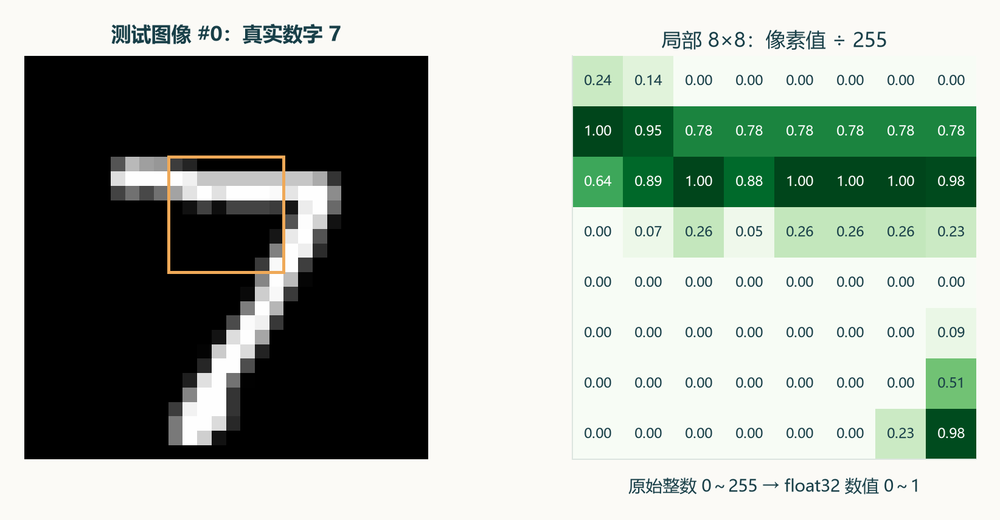
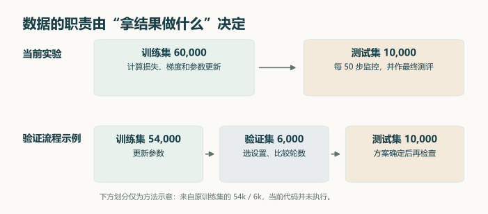

# 数据、张量与批次

神经网络接收的是数字。理解一张图片怎样变成张量、怎样组成一批，比直接进入训练循环更重要。这里对应 `data.py` 的 `load_data()` 和 `train.py` 中的 DataLoader。

## 从图片和正确答案开始 {#supervised-learning}

一个训练样本包含图片与标签，例如一张手写 7 的图片，以及整数 `7`。图片是输入，标签是希望模型给出的答案。训练时模型先预测，再根据预测与答案的差异更新参数，这种学习方式叫监督学习。

本实验的标签只有 0～9，模型每次只选一个类别，因此是十分类。输出十个值并不是要同时识别十张图片，而是在比较同一张图片属于十个候选类别的分数。

MNIST 包含 60,000 张官方训练图片和 10,000 张官方测试图片，每张图已经整理为 28 × 28 的单通道灰度图。它适合观察分类流程，但其背景、大小和构图都比真实拍照图片简单。识别 MNIST 表现好，不等于已经解决了拍照、背景复杂、多位数字等问题。[MNIST 作者资料](https://yann.lecun.com/exdb/publis/pdf/bengio-lecun-07.pdf)

## 图片怎样变成张量 {#image-to-tensor}

灰度图中一个像素只有一个亮度值。MNIST 的背景接近 0，笔画通常更亮；原始图像使用 0～255 的整数。`ToTensor()` 将这里的图片转换成浮点张量，并将像素除以 255，缩放到 0～1。

[](assets/pixels.png)

图中使用官方测试集 index=0 的图片，标签为 7。右侧截取其中 8 × 8 的局部，并显示转换后的像素值；文字四舍五入到两位小数，模型实际使用浮点数据。
{: .figure-caption }

```python
from torchvision import datasets, transforms

dataset = datasets.MNIST(
    root="data",
    train=True,
    transform=transforms.ToTensor(),
    download=True,
)
image, label = dataset[0]
print(image.shape)
print(image.dtype)
print(label)
```

图片形状是 `torch.Size([1, 28, 28])`，类型是 `torch.float32`；标签是一个类别整数。上面取的是训练集第一张图片，与图中用于展示的测试集 index=0 不是同一个样本。

这里的张量可以先理解为带有形状、数据类型和设备信息的多维数字数组。后续卷积、求损失、反向传播都在张量上进行。[ToTensor 的转换规则](https://docs.pytorch.org/vision/stable/generated/torchvision.transforms.ToTensor.html)

缩放到 0～1 不会把所有图片变得一样，也不等于把每张图变为零均值、单位方差。当前代码没有 `Normalize(mean, std)`；缩放、均值方差标准化和数据增强是不同操作，不能因为使用了 ToTensor 就认为它们全部已经完成。

## 四个维度分别表示什么 {#tensor-shape}

PyTorch 的这个 Conv2d 使用 `B × C × H × W` 的布局。一个 batch 中每张图都要保留通道维，灰度图的通道数是 1，而不是把这个维度省略。

| 维度 | 含义 | 本实验中的例子 |
| --- | --- | --- |
| B | 这一批有多少张图片 | 50 |
| C | 每张图片有多少个输入通道 | 1，灰度亮度 |
| H | 图片高度 | 28 |
| W | 图片宽度 | 28 |

单张图是 `[1, 28, 28]`，组合成一批以后是 `[50, 1, 28, 28]`。这里有 `50 × 1 × 28 × 28 = 39,200` 个像素值，不能把最前面的 50 当成图片宽度。

```python
from torch.utils.data import DataLoader

loader = DataLoader(dataset, batch_size=50, shuffle=True)
images, labels = next(iter(loader))
print(images.shape)
print(labels.shape)
print(labels.dtype)
```

图片批次形状是 `[50, 1, 28, 28]`，标签批次形状是 `[50]`，其中放着 50 个类别编号。默认组合后的整数标签是 `torch.int64`，也称 `long`，这正是本实验交叉熵需要的标签形式。

形状和数据类型解决不同问题：`[50]` 说明有 50 个标签，`int64` 说明它们是整数类别，而不是连续数值。模型输出则是 `[50, 10]`，每张图对应十个浮点分数。

RGB 图片通常有 3 个输入通道。把本模型直接喂入 RGB 图片会与 `in_channels=1` 不匹配；这是输入格式约定的差异，不能只修改 batch 大小来解决。

## batch、step、epoch 如何对应 {#batching}

Dataset 定义“有什么样本、如何按索引取样本”，DataLoader 负责把样本组合成可迭代的批次。它并不训练模型，真正的计算发生在拿到 `(images, labels)` 之后。

一次取出 50 张图，计算这一批的平均损失并更新一次参数，这里称一个训练 step。把 60,000 张训练图都遍历一遍是一个 epoch。

```text
每个 batch：50 张
每个 epoch：60,000 / 50 = 1,200 个训练 step
训练 5 个 epoch：5 × 1,200 = 6,000 次参数更新
```

默认 `drop_last=False`，样本数不能整除 batch size 时，最后一批可以更小。此处 60,000 与 10,000 都能被 50 整除，所以每个训练批次都是 50 张，每次完整测试有 200 批。

`shuffle=True` 在每次遍历时改变训练样本的顺序，减少每轮都以固定排列学习带来的影响；它不改变图片内容，也不会把训练集和测试集混在一起。测试使用 `shuffle=False`，便于保持样本索引与预测结果的对应关系。全量正确计数的准确率并不依赖测试顺序。

batch size 也不是越大越好。它影响显存占用、一次梯度估计所包含的样本数，以及每轮更新次数。固定看完相同的训练集时，batch 更大意味着每轮 step 更少；比较实验时要先分清“训练了相同轮数”和“更新了相同步数”。

## 训练集、验证集与测试集 {#dataset-split}

训练集用于计算损失和梯度；验证集用于观察模型、比较设置或选择训练轮数；测试集用于最终检查对未参与选择的数据的表现。验证和测试都可以计算准确率，区别主要是这些结果会被怎样用于决策。

[](assets/dataset_split.svg)

上方是当前代码的使用方式。箭头表示训练与评估的流程顺序，不表示把训练样本移入测试集。下方的 54,000 / 6,000 划分只是一个可扩展的验证方案，现有代码并未执行该划分，也没有修改数据加载逻辑。
{: .figure-caption }

当前代码没有单独的验证集，而是在训练过程中每 50 步查看一次完整官方测试集。这些图片没有参与 backward；不过，如果据此反复调学习率、轮数或挑选模型，测试结果就参与了模型选择。为什么这会影响对泛化能力的解释，见 [评估中的验证边界](evaluation.md#generalization)。

下一篇从这些形状出发，解释 [卷积网络怎样处理图片](cnn.md)。
