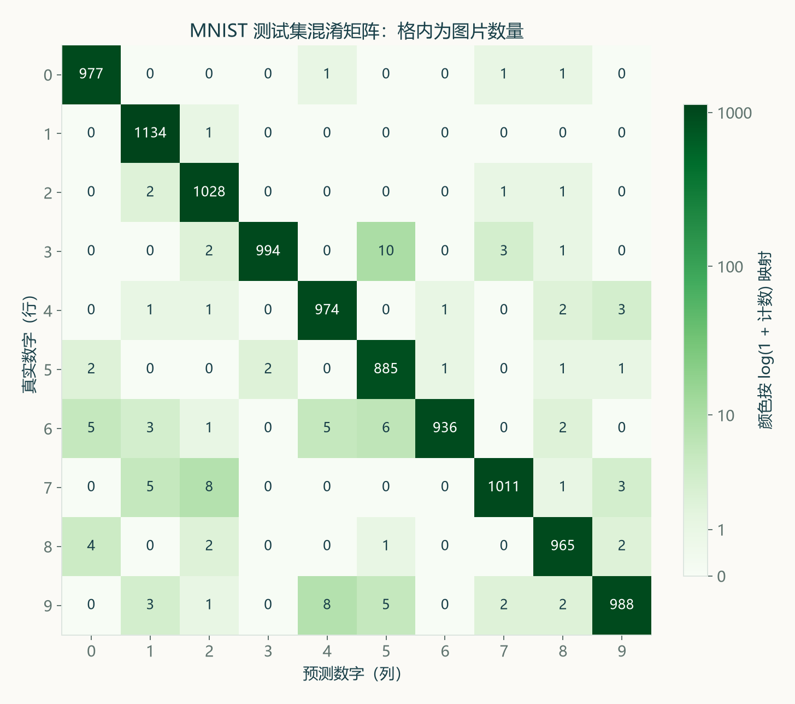
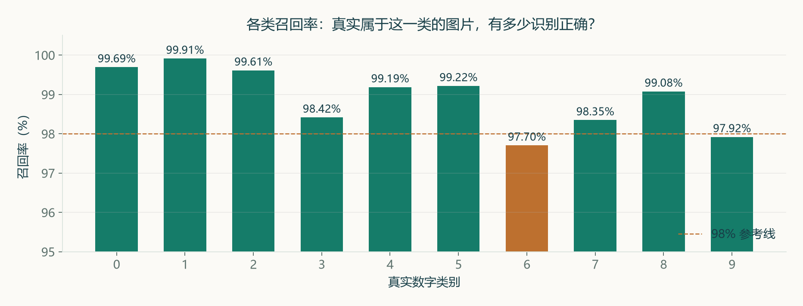
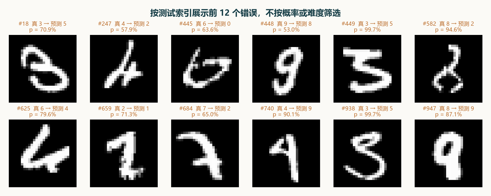
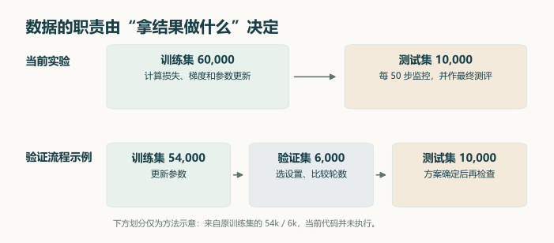

# 评估：准确率之外还要看什么

一个总分能快速说明模型识别了多少图片，但不能告诉我们哪些数字难、错误集中在哪里，或结果能否推广到其他输入。这里从 `engine.py` 的 evaluate 出发，结合原实验保存的预测记录解释评估方法。

## 准确率怎样计算 {#accuracy}

```python
pred_y = output.argmax(1)
correct += (pred_y == b_y).sum().item()
total += b_y.size(0)
```

`pred_y == b_y` 按图片比较预测与真实类别，得到布尔张量。sum 统计本批正确数，再累计到整套数据；最终准确率为 `correct / total`。

这次原实验记录为 `9892 / 10000 = 98.92%`，错误数为 108。分母是全部测试图片数量，不是测试 batch 数，也不是训练集数量。先累加正确数和样本数，再做一次除法，能够正确处理最后一批大小不同的情况。

准确率只区分“是否选对类别”，不会区分一个误判模型有多确定，也不会反映不同错误类别的代价。类别数量很不均衡时，还可能被样本多的类别主导；MNIST 各类数量相近，但仍不完全相等。

## 混淆矩阵怎样定位问题 {#confusion-matrix}

混淆矩阵给每一种“真实类别 → 预测类别”组合计数。这里固定使用**行是真实数字，列是预测数字**；看其他图时也要先确认方向。

[](assets/confusion_matrix.png)

矩阵来自 [analysis.json](records/analysis.json)，共 10,000 张图片。颜色按 `log(1 + 计数)` 显示，以便同时看清大对角线和少量错误；格内文字始终是原始计数，不是对数或百分比。
{: .figure-caption }

对角线表示识别正确；非对角线表示错误。某一行求和得到该真实数字的测试样本数，某一列求和得到模型预测为该数字的图片总数。

本次较多的混淆是 `3 → 5` 的 10 张、`7 → 2` 的 8 张、`9 → 4` 的 8 张，以及 `6 → 5` 的 6 张。`3 → 5` 与 `5 → 3` 不是同一件事，两个方向的数量也不必相等。

例如数字 3 共有 1,010 张，其中 994 张预测正确，10 张被判成 5，其余错误分散在其他列。矩阵让我们知道该去查看哪一类图像，而不是只凭总准确率猜测。

## Precision、Recall 与 F1 怎么理解 {#class-metrics}

固定看一个数字时，可以将问题临时看成“是这个数字 / 不是这个数字”。正确找出的该类图片叫 TP；其他数字被错认成该类叫 FP；真实属于该类、却被错分到别类叫 FN。

| 指标 | 计算 | 回答的问题 |
| --- | --- | --- |
| Precision，精确率 | `TP / (TP + FP)` | 模型说“这是 6”的图片中，有多少真的为 6？ |
| Recall，召回率 | `TP / (TP + FN)` | 所有真实的 6 中，模型找对了多少？ |
| F1 | `2 × Precision × Recall / (Precision + Recall)` | 综合考虑精确率和召回率 |

以数字 6 为例：真实有 958 张，正确预测 936 张，漏掉 22 张；模型一共把 938 张图判成 6，其中只有 2 张来自其他类别。因此精确率约为 99.79%，召回率约为 97.70%。它很少“把别的数字认成 6”，但漏掉了一部分真正的 6，这两种现象不能混为一谈。

[](assets/class_recall.png)

柱高是各类召回率，虚线只是 98% 的视觉参考，不代表要求每个数字都超过这条线。纵轴从 95% 开始，以便看清接近的结果；比较柱高时需留意这个截断范围。
{: .figure-caption }

| 数字 | 真实样本数 | Precision | Recall | F1 |
| ---: | ---: | ---: | ---: | ---: |
| 0 | 980 | 0.9889 | 0.9969 | 0.9929 |
| 1 | 1,135 | 0.9878 | 0.9991 | 0.9934 |
| 2 | 1,032 | 0.9847 | 0.9961 | 0.9904 |
| 3 | 1,010 | 0.9980 | 0.9842 | 0.9910 |
| 4 | 982 | 0.9858 | 0.9919 | 0.9888 |
| 5 | 892 | 0.9757 | 0.9922 | 0.9839 |
| 6 | 958 | 0.9979 | 0.9770 | 0.9873 |
| 7 | 1,028 | 0.9931 | 0.9835 | 0.9883 |
| 8 | 974 | 0.9887 | 0.9908 | 0.9897 |
| 9 | 1,009 | 0.9910 | 0.9792 | 0.9850 |

宏平均 F1 是十个类别 F1 的算术平均，本次约为 0.989082，每个类别占同样权重。它不是先平均 Precision 和 Recall 再计算 F1，也不是整体准确率的另一个名称。表中数值经过四舍五入，完整精度保存在记录中。

## 回到具体图片看误判 {#errors}

[](assets/errors.png)

图片来自原实验保存的 examples.npz，按官方测试索引选取前 12 个错误；不是随机抽样，也没有按难度或概率排序。p 是预测类别的 softmax 值，数值经过显示舍入。
{: .figure-caption }

对照图片后，可以提出一些解释：某些写法的笔画可能接近另一个数字，倾斜、连接或缺少明显弯折可能影响判断。但这些是观察后的假设，没有额外对照实验时，不应把它们写成已经证明的原因。

需要把“这张图为什么错”与“某类图通常为什么错”区分开。少量样例适合帮助理解，不能代表全部 108 张错误的分布；需要统计时，应回到 [全部测试预测](records/test_predictions.csv)。

softmax 最大值很高也可能预测错误。它表示模型在这十个候选类别中的相对分配，不自动保证现实中有相同的正确概率；例如 p 为 99% 并不意味着这张具体图片已经被证明有 99% 的识别可靠度。是否能作可靠度解释，需要另行检查概率校准。

对不属于数字的输入，本模型仍然会输出十个分数并选择一个最大值。它没有额外的“不是数字”类别，因此不能把强制选出的数字当成已经验证了输入确实是手写数字。

## 如何解释测试结果与泛化 {#generalization}

泛化关注模型对未用于拟合与选择的数据的表现。测试集独立，不仅要求没有对它 backward，也要求不反复依据其结果决定下一步怎样修改模型。

[](assets/dataset_split.svg)

54,000 / 6,000 是从官方训练集再划分训练与验证的示例，未改动当前代码。真正比较设置时，还要固定划分方式与评价口径。
{: .figure-caption }

当前每 50 步评估一次测试集，五轮训练中共测评 120 次，结束后再做最终测评。代码固定训练 5 轮，保存最后的权重；它没有根据测试曲线自动提前停止。但如果人根据这些测试结果反复更改超参数，测试集就承担了验证用途。

这不意味着准确率计算错了，也不意味着测试图像参加了梯度训练。它意味着应把 98.92% 理解为“当前保存模型在这套已经被监控的 MNIST 测试集上的结果”，不能再称为完全未观察过的最终留出评估。

更规范的比较方式是从官方训练集中另留验证集，使用验证结果选择设置；确定方案后，再使用此前不参与选择的官方测试集。这里先理解这种职责划分，后续实验可在实现数据划分时引用本节，而不必重复整段说明。

对自己拍摄的数字，也需要检查缩放、灰度、反色、背景、居中方式是否与 MNIST 接近。输入分布发生变化后，MNIST 的准确率不能直接代替新场景的测试结果。

## 记录里的数字各自代表什么 {#records}

| 保存的量 | 数值 | 统计口径 |
| --- | ---: | --- |
| 最终测试准确率 | 98.92% | 10,000 张测试图，9,892 张正确 |
| 完整测试平均交叉熵 | 0.0317122444 | 将全部测试图片损失相加，再除以 10,000 |
| 最后记录的训练损失 | 0.0052054781 | 最后一个记录点对应的 50 张训练图，更新前的 batch 均值 |
| 宏平均 F1 | 0.9890821327 | 十个类别 F1 的算术平均 |
| 训练阶段用时 | 约 145.6 秒 | 包含周期测评、权重 / CSV 保存和最终测试 |

测试损失与准确率反映不同事情：预测都正确的两个模型，也可能对正确类别给出不同概率；一两张高分误判会明显影响交叉熵，却只改变很小一部分正确计数。左边的训练 batch 损失与右边完整测试平均损失，不能只按数值大小比较为“训练集一定比测试集好这么多”。

这些分析来自原实验保存的同一组预测。独立加载权重复核的正确数仍为 9,892；它检查了保存与加载流程的一致性，不等于在另一套独立测试数据上再次验证。

原始记录可直接下载：[训练配置](records/config.json)、[运行环境](records/environment.json)、[最终指标](records/metrics.json)、[加载复核](records/reevaluation.json)、[分类分析](records/analysis.json)、[训练曲线数据](records/history.csv)、[逐张预测](records/test_predictions.csv)。[来源与 SHA256](records/provenance.json) 记录了这些文件与所用权重的对应关系。
