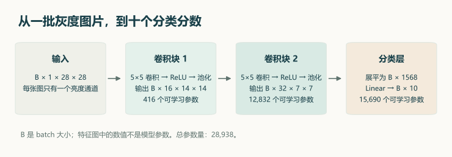
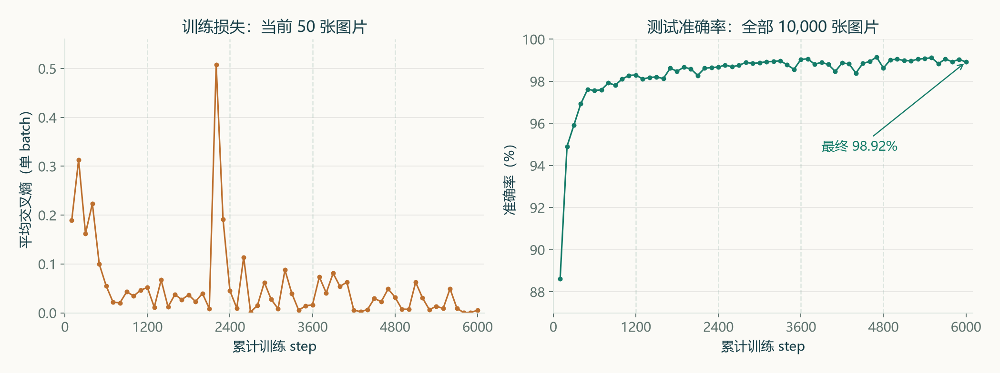

# 01 · 用卷积网络识别手写数字

输入一张 28 × 28 的灰度图片，输出它属于数字 0～9 的哪一类。这是一个有标签的十分类问题：我们不手工规定“上面一个圈就是 9”，而是让模型从大量图片与正确答案的对应关系中调整参数。

对应 Demo：[`code/1_mnist_cnn/`](https://github.com/Accelerator-xm/DP_notebook/tree/main/code/1_mnist_cnn)。笔记补充计算过程和概念，不替换原代码或其中的注释。

## 先把整个过程连起来

每张图先生成 16 张特征图，再生成 32 张更小的特征图。最后将 32 × 7 × 7 个值排列成一行，计算十个原始分类分数。训练会改变卷积核与分类层权重，图片本身不会因为 backward 而被修改。
{: .figure-caption }

“特征”可以先理解为图片里对判断有用的某种响应，例如某个位置出现了一段笔画。特征图记录这种响应在不同位置的强弱；一个通道并不天然对应一个数字类别。

| 阅读顺序 | 主要问题 | 对应代码 |
| --- | --- | --- |
| [数据与张量](data.md) | 灰度图怎样变成数字，四个维度分别表示什么，批次如何组成 | `data.py`、`train.py` 的 DataLoader |
| [卷积网络](cnn.md) | 局部计算、通道、激活、池化、尺寸与参数量 | `model.py` |
| [训练与梯度](training.md) | 分数如何变成损失，参数怎样被更新，怎样阅读训练曲线 | `engine.py`、`train.py` |
| [评估与误差分析](evaluation.md) | 准确率以外的指标、错误图像、测试集的使用边界 | `engine.py`、`evaluate.py` 与原实验记录 |

后续实验再次涉及这些概念时，直接引用对应章节；只为新的网络结构、数据处理或训练方法增加内容。

## 这次实现采用的设置

| 项目 | 当前设置 |
| --- | --- |
| 数据 | MNIST 官方训练集 60,000 张、测试集 10,000 张 |
| 预处理 | `ToTensor()`，没有额外的均值方差标准化或数据增强 |
| 模型 | 两个 Conv2d → ReLU → MaxPool2d 模块，加一个 Linear |
| 参数量 | 28,938 |
| 训练 | 5 个 epoch，batch size 为 50，共 6,000 次参数更新 |
| 优化 | Adam，学习率 0.001，交叉熵损失 |
| 保存 | 最后一轮结束时的 `state_dict`，不是按最高测试准确率挑选的权重 |

这是一套便于看清完整训练过程的小网络。它没有使用 Dropout、BatchNorm、学习率调度或迁移学习，理解这些方法不是阅读本实验的前提。

## 保存的实验结果

原实验在 2026-11-17 保存的一次运行得到 **98.92%（9,892 / 10,000）** 的测试准确率，共误判 108 张；完整测试集的平均交叉熵约为 **0.031712**。本仓库整理笔记时没有重新训练，图表依据保存的 CSV / JSON 和权重生成。数据来源与哈希记录见 [provenance.json](records/provenance.json)。

横轴是累计参数更新次数。左侧每个点只代表当时的 50 张训练图片，右侧每个点代表全部 10,000 张测试图片，两条线的统计范围不同。曲线不是重新训练或手工编造的结果。
{: .figure-caption }

先读懂“输入怎样通过模型”和“一次更新做了什么”，再回来看曲线为什么会抖动、98.92% 可以说明哪些事。运行命令与环境安装见 [仓库 README](https://github.com/Accelerator-xm/DP_notebook#运行-mnist-demo)。

!!! note "关于代码片段"
    笔记只摘取理解知识点所需的短片段，省略说明性注释。包含 `from model import CNN` 的独立演示可在 `code/1_mnist_cnn/` 目录运行；完整训练仍使用原来的 `train.py`。
