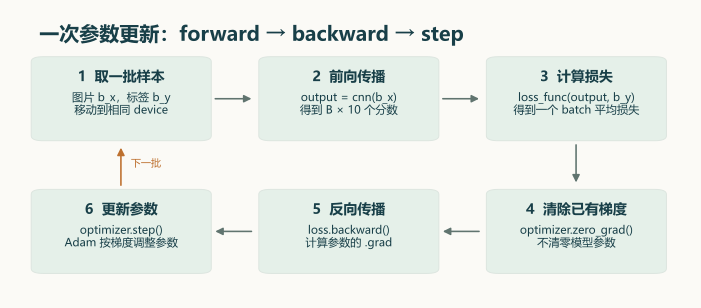
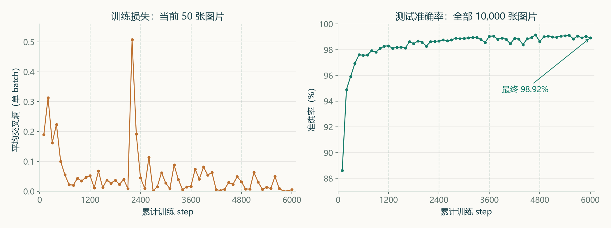

# 训练：损失、梯度与参数更新

前向传播让模型根据当前参数给出分数，训练则用正确答案告诉模型哪些参数应该怎样调整。这里对应 `engine.py` 中的训练循环，以及 `train.py` 中的损失函数和 Adam 优化器。

## 从分类分数到交叉熵损失 {#loss}

模型对每张图片输出十个原始分数，也叫 logits。最大分数所在的位置就是当前预测类别，`output.argmax(1)` 沿类别维选择最大值的位置，不需要先计算概率。

如果想把分数变为和为 1 的数值，可以使用 softmax：

```text
p_i = exp(z_i) / 所有类别 exp(z_j) 的总和
```

它保留类别的大小顺序，同时把各类别放在同一个相对比较中。所有分数同时加上一个常数，不会改变 softmax 结果；单个分数的绝对值不能直接当成概率。

交叉熵关注正确类别分到的概率。对一张图片，如果真实标签是 y，它的损失为 `−log(p_y)`。正确类别概率越低，惩罚越大；正确类别已经排第一，也仍可能因为模型不够确定而有较大的损失。

| 正确类别的概率 | 对应损失，使用自然对数 |
| ---: | ---: |
| 0.9 | 约 0.105 |
| 0.5 | 约 0.693 |
| 0.1 | 约 2.303 |
| 0.01 | 约 4.605 |

下面先用三个类别缩小计算规模；本实验十分类使用同样规则：

```python
import torch
from torch import nn

scores = torch.tensor([[2.0, 1.0, 0.0]])
target = torch.tensor([0])
probabilities = scores.softmax(dim=1)
loss = nn.CrossEntropyLoss()(scores, target)
print(probabilities)
print(loss.item())
```

softmax 约为 `[0.6652, 0.2447, 0.0900]`，真实类别 0 对应损失约 0.4076。如果真实类别是 2，损失会变为约 2.4076，表示相同预测对不同正确答案的错误程度不同。

PyTorch 的 `CrossEntropyLoss` 直接接收 logits，并在内部完成稳定的 log-softmax 与标签损失计算。本实验应传 `output` 和整数标签 `b_y`，而不是先把 output 变成 softmax 再传入。重复 softmax 会改变要优化的函数。[CrossEntropyLoss](https://docs.pytorch.org/docs/2.14/generated/torch.nn.CrossEntropyLoss.html)

对一个 batch，输入形状是 `[B, 10]`，目标形状是 `[B]`、类型为 long，值在 0～9 之间。这里不需要把标签写成 one-hot。默认损失是这 B 张图的平均值，所以当前 batch 中少数很难或被高分误判的样本，也可能明显拉高 loss。

## 梯度怎样告诉参数往哪调整 {#autograd}

损失告诉我们“当前预测有多不符合正确答案”，梯度则告诉我们“某个参数稍微改变时，损失会怎样变化”。反向传播将这个影响从损失一路传回各层参数。

先用一个标量例子看清求导，暂时不使用卷积和交叉熵：

```python
import torch

w = torch.tensor(2.0, requires_grad=True)
prediction = w * 3
loss = (prediction - 1).square()
loss.backward()
print(loss.item())
print(w.grad.item())
```

当前预测是 6，希望接近 1，平方损失为 25。损失对预测的变化率是 `2 × (6 − 1) = 10`，预测对 w 的变化率是 3，因此对 w 的梯度为 `10 × 3 = 30`。这就是链式法则：把每一步的影响相乘，得到最终影响。

正梯度说明在当前位置稍微增大 w 会增大损失，所以梯度下降沿相反方向调整。最简单的更新形式是 `新参数 = 旧参数 − 学习率 × 梯度`。本实验用的是 Adam，它会进一步利用历史梯度调整实际更新量。

PyTorch 在前向计算时记录可求导操作，组成计算图；`backward()` 按这个图计算梯度，并写入参数的 `.grad`。它不是逐个试验“把权重加一点再重新跑一遍”，也不要求我们为每个卷积核手写导数。

每次前向会建立相应的计算图，正常 backward 后用于反传的中间缓存会被释放。`loss.item()` 只是取出 Python 数字用于日志，反向传播仍要对原来的 loss 张量调用，不能改成对这个 Python 数字求导。[自动求导](https://docs.pytorch.org/docs/2.14/notes/autograd.html)

## 一次训练 step 的完整顺序 {#update-step}

[](assets/training_loop.svg)

流程对应当前 `engine.py`。新的 batch 会重新进行前向计算；optimizer.step 修改参数，下一批输入随后看到的是更新后的模型。
{: .figure-caption }

```python
output = cnn(b_x)
loss = loss_func(output, b_y)
optimizer.zero_grad()
loss.backward()
optimizer.step()
```

`zero_grad()` 清除上批次留下的梯度。PyTorch 默认会累积梯度，如果两次 backward 之间不清理，新梯度会叠加到旧值上；这不会自动变成“记得更多知识”，而是改变了更新规则。显式梯度累积可以用于其他训练设计，但本实验每批更新一次。

清理梯度不等于把模型参数清零。`backward()` 负责计算梯度，也不直接更新权重；真正读取梯度并改变参数的是 `optimizer.step()`。实际清理时 `.grad` 可能被设为 None，而不一定逐元素写成 0。

本代码在计算 loss 后、backward 前清理梯度，能够保证本次反传不混入上次梯度。测评分支则只运行前向，不调用 backward 或 step。[参数优化流程](https://docs.pytorch.org/tutorials/beginner/basics/optimization_tutorial.html)

## Adam 和学习率分别起什么作用 {#optimizer}

学习率决定参数更新的基本尺度。过大时，一次调整可能跨过更好的区域，损失来回变化甚至失控；过小时，每次进展可能很小。不能因为损失暂时上涨，就直接认定学习率必须减半，还要看采样范围与持续趋势。

本实验创建 `torch.optim.Adam(cnn.parameters(), lr=0.001)`，将需要训练的参数交给优化器。Adam 会记录近期梯度的方向趋势，以及梯度平方的变化规模，让各参数的更新尺度可以有所区别。可以把它理解为同时参考“最近往哪走”和“这个方向的变化通常有多大”。

Adam 不会替我们自动选择好所有设置：lr 仍需要指定，数据、模型与训练轮数仍然影响结果。当前实现没有学习率调度器，也没有显式的 weight decay，不应把后面的曲线改善解释成这些未使用方法带来的效果。

epoch 数量、batch size、学习率是训练前选择的超参数；卷积权重和线性层权重是训练中学习的模型参数。修改 `BATCH_SIZE` 会同时影响每批样本数和每轮 step 数，比较设置时应明确训练预算。

## train、eval 与 no_grad 的区别 {#modes}

`cnn.train()` 和 `cnn.eval()` 切换模块的训练 / 评估模式。Dropout、BatchNorm 等层会根据这个模式改变行为；本网络只使用卷积、ReLU、池化和线性层，没有这两类模式相关层，因此这里的模式切换不改变这些层的计算规则。

`torch.no_grad()` 则控制是否记录用于自动求导的计算图。评估不需要计算参数梯度，禁用记录可以减少内存和相关开销。

```python
cnn.eval()
with torch.no_grad():
    output = cnn(b_x)
    pred_y = output.argmax(1)
```

这两种机制各管一件事：`eval()` 不会自动关闭梯度记录，`no_grad()` 也不会自动切换模式。本实验的 evaluate 同时使用它们；训练中临时测评结束后，又执行 `cnn.train()` 恢复模式，方便以后扩展模型时继续保持正确流程。

## 怎样阅读实际训练曲线 {#learning-curves}

[](assets/learning_curves.png)

曲线直接使用 [history.csv](records/history.csv) 的全部 60 个点，没有平滑。竖线标记 epoch 边界；左图不是 epoch 平均损失，也不是完整训练集损失。
{: .figure-caption }

代码每 50 个训练 step 对完整测试集测评并打印，每 100 步保存一条历史。每轮 1,200 个 step，训练五轮共保存 60 个点。同行的 train_loss 来自更新前那次前向计算，test_accuracy 来自本次更新后的完整测试集评估。

左侧损失会抖动，因为记录点对应不同的 50 张图片。有的 batch 更容易，有的包含较难样本；第 2,200 步约 0.5074 的损失不能单独证明模型整体退化。最后的 0.005205 也只说明最后一个被记录训练批次的情况。

右侧准确率在前期上升明显，后期接近 99% 后仍有上下变化。这次第 4,700 步曾记录到 99.15%，最终为 98.92%。当前代码保存训练结束时的模型，没有按曲线峰值保存“最佳模型”。

判断过拟合，通常需要比较相同统计口径的训练与独立验证表现：训练持续改善，而验证表现持续恶化，才是值得进一步检查的信号。这里缺少完整训练集损失、验证集损失曲线，不能仅凭某几个 batch 的尖峰给出确定结论。

另外，每 50 步跑一次完整测试需要额外计算。记录中的约 145.6 秒包含这些周期测评、权重和 CSV 保存，以及最终测试，不是单纯进行 6,000 次更新的时间，也不能直接拿来与只测一次的训练速度比较。

## 设备、保存与复现 {#checkpoints}

`device` 决定张量在哪里计算。模型、图片和标签要在兼容的同一设备上；`.to(device)` 负责迁移。没有可用 CUDA 时，当前代码回退到 CPU，网络结构与目标函数不因此改变。

训练结束用 `torch.save(cnn.state_dict(), ...)` 保存模型状态。重新加载时先构建同样结构的 CNN，再把参数装回去：

```python
cnn = CNN().to(device)
state = torch.load("results/cnn.pth", map_location=device, weights_only=True)
cnn.load_state_dict(state)
cnn.eval()
```

`state_dict` 记录命名参数以及模块注册的持久缓冲区。本网络主要是两层卷积和线性层的权重、偏置；它不等于整个 Python 类定义，改变通道数或分类层长度后，保存的参数可能无法匹配。

保存权重足以复核当前模型的预测，但不等于保存完整训练现场。这里没有保存 Adam 的历史状态、当前轮数和随机数状态，不能据此承诺精确续训。训练代码也没有固定随机种子，初始化和 shuffle 的变化都会让下一次运行的结果有所不同。[模型保存与加载](https://docs.pytorch.org/tutorials/beginner/basics/saveloadrun_tutorial.html)

下一篇继续看 [怎样评估模型、解释错误与使用测试集](evaluation.md)。
