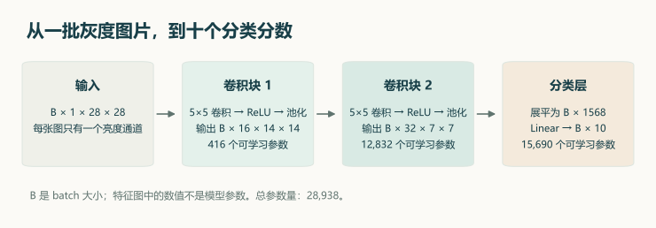

# 深度学习 · 实验与笔记

一张图片是像素，模型接收的是张量，训练调整的是参数。把这几件事连起来，比先记住很多模型名称更容易理解深度学习。

这里按实验积累知识：每个 Demo 都有同名的笔记目录，解释代码为什么这样写、数据经过每层会怎样变化，以及结果能够说明什么。已经讲过的基础在后续实验中通过链接复用。

## 从第一个实验开始

| 实验 | 这次主要理解什么 | 入口 |
| --- | --- | --- |
| 01 · MNIST 卷积网络 | 从灰度图片、张量和批次，到卷积、梯度更新及分类评估 | [进入实验](1_mnist_cnn/index.md) · [查看代码](https://github.com/Accelerator-xm/DP_notebook/tree/main/code/1_mnist_cnn) |

图中是实验一的网络结构，`B` 表示一次送入的图片数。后面的笔记会逐步解释每个框，而不是把这些名称当成需要直接记忆的黑箱。
{: .figure-caption }

## 按问题查知识

| 想解决的问题 | 已有解释 |
| --- | --- |
| 图片为什么是 `B × 1 × 28 × 28`？ | [图片、张量与维度](1_mnist_cnn/data.md#tensor-shape) |
| batch、step、epoch 有什么区别？ | [一次训练到底看了多少数据](1_mnist_cnn/data.md#batching) |
| 卷积核如何学到笔画，为什么是 16 / 32 个通道？ | [卷积与特征图](1_mnist_cnn/cnn.md#convolution) |
| 每层的尺寸和 28,938 个参数怎么算？ | [尺寸与参数量](1_mnist_cnn/cnn.md#size-and-parameters) |
| 为什么要 ReLU、池化、展平？ | [激活](1_mnist_cnn/cnn.md#activation) · [池化](1_mnist_cnn/cnn.md#pooling) · [分类层](1_mnist_cnn/cnn.md#classifier) |
| 为什么交叉熵前没有 softmax？ | [分数、概率与损失](1_mnist_cnn/training.md#loss) |
| backward、zero_grad、step 分别做什么？ | [梯度与参数更新](1_mnist_cnn/training.md#update-step) |
| eval 与 no_grad 为什么要一起用？ | [模型模式与梯度记录](1_mnist_cnn/training.md#modes) |
| 准确率很高，还应该看什么？ | [混淆矩阵与分类指标](1_mnist_cnn/evaluation.md#confusion-matrix) |
| 看过很多次的测试集，还算独立测试吗？ | [验证集与泛化](1_mnist_cnn/evaluation.md#generalization) |

笔记里的结构图、卷积计算和训练流程图用于解释原理；学习曲线、混淆矩阵与识别样例来自保存的实验记录。每张图都注明统计口径，点击图片可以查看原图。
